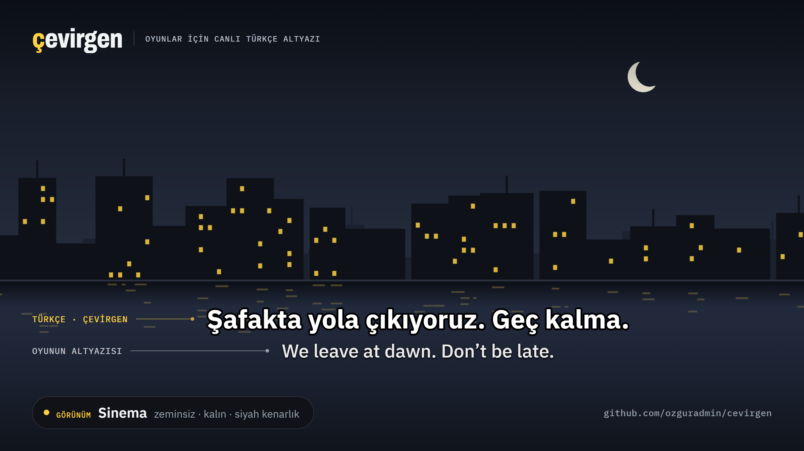

<h1 align="center">Çevirgen</h1>

<b>Live Turkish subtitles for games.</b> 
Çevirgen reads a game's English subtitles from the screen, translates them into Turkish and shows them on your TV over the game. It works with any game that has subtitles.

<a href="https://github.com/ozguradmin/cevirgen/releases/latest"><b>Download (Windows)</b></a> · <a href="README.md">Türkçe</a>

Çevirgen is built for Turkish players: the app interface is available in Turkish and English, and translations go from English into Turkish.

## Features

- Turkish subtitles for games without Turkish support: PS5, Xbox, PC games, and other consoles through a capture card.
- Free offline translation by default (OPUS-MT on your PC); optional Gemini, DeepL, OpenAI, Claude or any OpenAI-compatible endpoint (OpenRouter, Groq, LM Studio…).
- Readable subtitles (outlined text, readability test on dark and bright scenes); the Turkish line disappears together with the game's subtitle.
- Your own corrections and a glossary with rules; reading-speed check against the 17 characters/second subtitle limit; export a session as .srt.
- Short setup: 4 steps on PS5, 2 steps for PC games.

## Two looks

**Cinema** · no background, bold, black outline; just above the game's English line.

**Classic box** · a dark box that replaces the English line.

## How it works

Çevirgen watches the game's picture (Remote Play from a free second PSN account on PS5, its own connection on Xbox, the game window on PC), reads only the areas you choose, translates them and shows the Turkish line on an Android TV over the game, or on the PC screen. Nothing is installed on the console or in the game.

## Install

Download `CevirgenApp-win-Setup.exe` from the [latest release](https://github.com/ozguradmin/cevirgen/releases/latest) and run it. The installer is not signed yet: if SmartScreen warns, choose **More info › Run anyway**. If **Smart App Control** is on, Windows blocks unsigned apps without that option; turn it off in **Settings › Privacy & security › Windows Security › App & browser control › Smart App Control settings**. On older Windows 11 builds it cannot be turned back on without resetting Windows.

## Privacy

An anonymous usage count (random ID, version, platform every 5 minutes) and, to build better ready-made translations, the English lines read on screen with their translations and the game name are sent. Personal data such as e-mail addresses or phone numbers is filtered out. Both can be turned off in Settings › App. Details: [PRIVACY.md](PRIVACY.md).

## Contact

Support and feedback: **destek@ozgurguler.tech** · Developer: [ozgurguler.tech](https://ozgurguler.tech/professional) · [Report an issue](https://github.com/ozguradmin/cevirgen/issues)

## License

[GNU AGPL-3.0](LICENSE.txt). Çevirgen is derived from the open-source CouchSubs project; copyright and modification notices are in [NOTICE](NOTICE), third-party components in [THIRD-PARTY-NOTICES.md](THIRD-PARTY-NOTICES.md). Not affiliated with Sony Interactive Entertainment, Microsoft or any game publisher. The scene in the screenshots and promo images is Çevirgen's own drawing; the sample lines were written for them.
