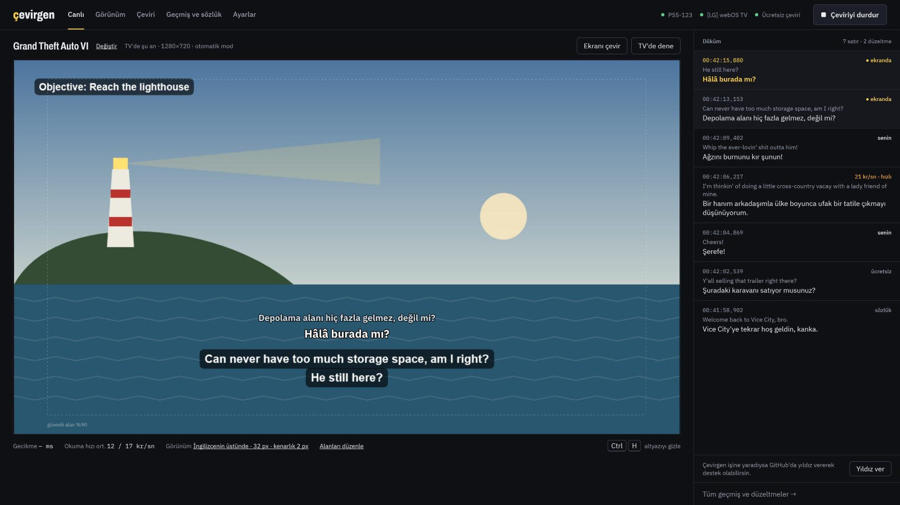

<h1 align="center">Çevirgen</h1>

<b>Live Turkish subtitles for games.</b> 
Çevirgen reads a game's English subtitles from the screen, translates them into Turkish and shows them on your TV over the game. It works with any game that has subtitles.

<a href="https://github.com/ozguradmin/cevirgen/releases/latest"><b>Download (Windows)</b></a> · <a href="README.md">Türkçe</a>

Çevirgen is built for Turkish players: the app interface is available in Turkish and English, and translations go from English into Turkish.

## Features

- Turkish subtitles for games without Turkish support: PS5, Xbox, PC games, and other consoles through a capture card.
- Free offline translation by default (OPUS-MT on your PC); optional Gemini, DeepL, OpenAI, Claude or any OpenAI-compatible endpoint (OpenRouter, Groq, LM Studio…).
- Readable subtitles (outlined text, readability test on dark and bright scenes); the Turkish line disappears together with the game's subtitle.
- Your own corrections and a glossary with rules; reading-speed check against the 17 characters/second subtitle limit; export a session as .srt.
- Short setup: 4 steps on PS5, 2 steps for PC games.

## Privacy

An anonymous usage count (random ID, version, platform every 5 minutes) and, to build better ready-made translations, the English lines read on screen with their translations and the game name are sent. Personal data such as e-mail addresses or phone numbers is filtered out. Both can be turned off in Settings › App. Details: [PRIVACY.md](PRIVACY.md).

## License and credits

Çevirgen is a modified version of **[CouchSubs](https://github.com/yorulmazsinan/couchsubs)** by Sinan Yorulmaz (based on v0.1.0-beta.88, modified from 2026-11-23). CouchSubs © 2026 Sinan Yorulmaz. Both are licensed under the [GNU AGPL-3.0](LICENSE); see [NOTICE](NOTICE) for the summary of changes. Çevirgen is not affiliated with CouchSubs, Sony Interactive Entertainment, Microsoft or any game publisher; CouchSubs' translation packs are not part of Çevirgen. Remote Play via [chiaki-ng](https://github.com/chiaki-ng/chiaki-ng) (AGPL-3.0); translation model OPUS-MT (University of Helsinki, CC BY 4.0); fonts IBM Plex and Archivo (SIL OFL 1.1); more in [THIRD-PARTY-NOTICES.md](THIRD-PARTY-NOTICES.md).
