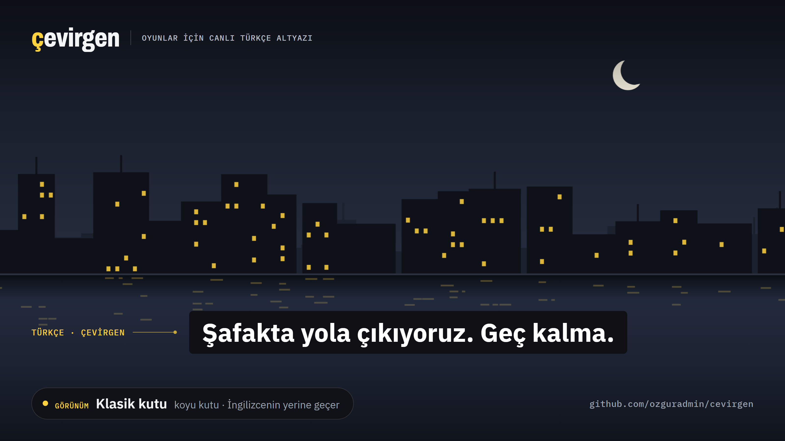
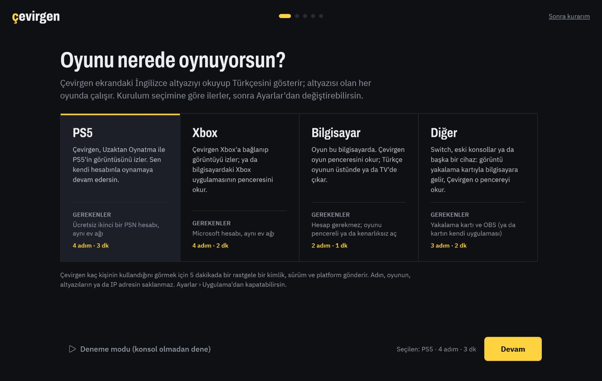
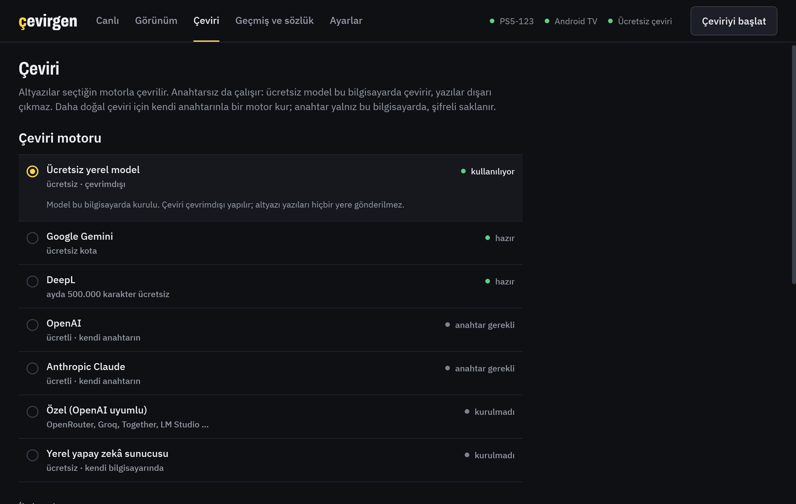
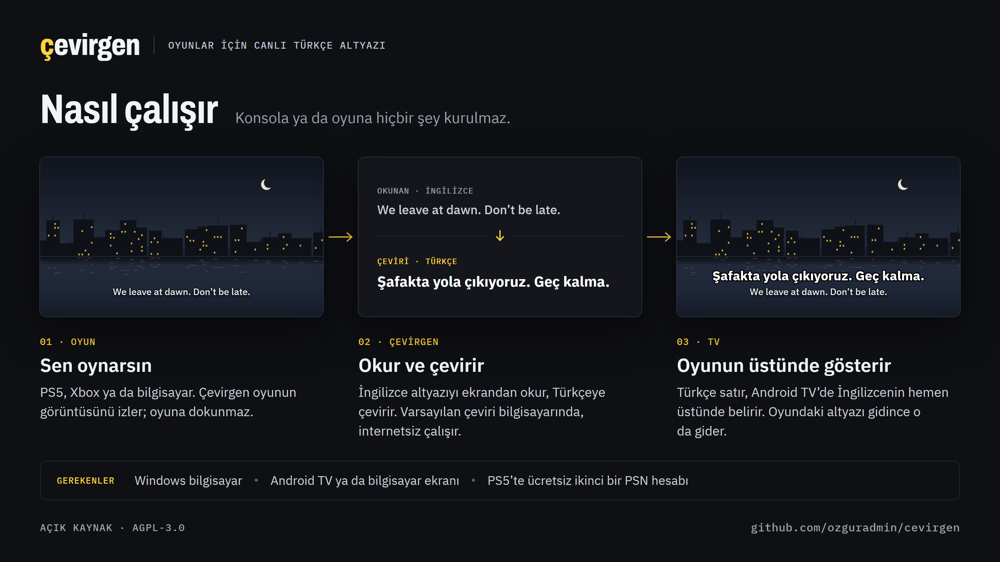

<p align="center"></p>

<h1 align="center">Çevirgen</h1>

<p align="center"><b>Oyunlar için canlı Türkçe altyazı.</b><br>
Ekrandaki İngilizce altyazıyı okur, Türkçeye çevirir ve TV'de oyunun üstünde gösterir. Altyazısı ekranın altında, ortada çıkan çoğu oyunda çalışır.</p>

<p align="center">
  <a href="https://github.com/ozguradmin/cevirgen/releases/latest"><b>İndir (Windows)</b></a> ·
  <a href="#kurulum">Kurulum</a> ·
  <a href="#nasıl-çalışır">Nasıl çalışır</a> ·
  <a href="#gizlilik">Gizlilik</a> ·
  <a href="README.en.md">English</a>
</p>

<p align="center"><sub>Windows uygulamayı açmıyor mu? <a href="#windows-uygulamayı-açmıyorsa">Ne yapacağın burada</a>.</sub></p>


## Ne yapar

- **Türkçesi olmayan oyunlara Türkçe altyazı.** Oyunun İngilizce altyazısını ekrandan okur, Türkçesini TV'de İngilizcenin hemen üstünde gösterir.
- **Her platform:** PS5, Xbox, bilgisayar oyunları ve yakalama kartıyla diğer konsollar.
- **İnternetsiz ücretsiz çeviri.** Varsayılan çeviri modeli bilgisayarında çalışır, çeviri için internet gerekmez (çevirileri iyileştirmeye katkı ayarı için [Gizlilik](#gizlilik) bölümüne bak). İstersen Gemini, DeepL, OpenAI, Claude ya da OpenAI uyumlu herhangi bir servisi (OpenRouter, Groq, LM Studio…) bağlarsın.
- **Okunur altyazı.** Zeminsiz, kenarlıklı yazı; okunurluk testiyle gece de kar sahnesinde de okunduğunu görürsün. Oyundaki altyazı gidince Türkçesi de hemen gider.
- **Düzelt ve sözlük.** Beğenmediğin çeviriyi düzeltirsin, o satır bir daha hep senin hâlinle gelir. "Şehir adları çevrilmesin", "buddy hep kanka olsun" gibi kurallar koyarsın.
- **Okuma hızı.** Her satırın saniyedeki karakter sayısı ölçülür; profesyonel altyazı sınırını (17 kr/sn) aşan satırlar işaretlenir.
- **Oturumu .srt olarak kaydet.** Türkçe ya da iki dilli altyazı dosyası.
- **Kolay kurulum.** PS5 için 4 adım, bilgisayar oyunları için 2 adım.

## İki görünüm

Altyazının TV'de nasıl duracağını sen seçersin; Görünüm sekmesinden tek tıkla değişir.

**Sinema** · zeminsiz, kalın, siyah kenarlıklı; İngilizcenin hemen üstünde.


**Klasik kutu** · koyu kutu, İngilizcenin yerine geçer.



## Ekranlar

| | |
|---|---|
|  |  |
| **İlk açılış** · PS5, Xbox, bilgisayar ya da diğer | **Görünüm** · aynı satır gece, gölge, gündüz ve karda |
|  |  |
| **Çeviri** · anahtarsız da çalışır, istersen kendi motorun | **Geçmiş ve sözlük** · satırın içinde düzelt, .srt kaydet |


## Nasıl çalışır



1. **Görüntü:** PS5'te Çevirgen, Uzaktan Oynatma ile ücretsiz ikinci bir PSN hesabından oyunun görüntüsünü izler; sen kendi hesabınla oynamaya devam edersin. Xbox'a kendisi bağlanır; bilgisayar oyunlarında oyun penceresini okur.
2. **Okuma:** Yalnız seçtiğin alanları (altyazı, ipuçları…) yazı tanımayla okur. Alanlar her oyun için ayrı saklanır.
3. **Çeviri:** Seçtiğin motorla Türkçeye çevirir; tuş ipuçlarını ve menü komutlarını ayrı tanır.
4. **Gösterim:** Türkçe satır Android TV'deki Çevirgen TV uygulamasıyla oyunun üstünde, ya da bilgisayar ekranında görünür.

## Kurulum

1. [Son sürümü indir](https://github.com/ozguradmin/cevirgen/releases/latest) ve `CevirgenApp-win-Setup.exe`'yi çalıştır.
2. Windows uyarırsa ya da açmazsa hemen aşağıdaki [Windows uygulamayı açmıyorsa](#windows-uygulamayı-açmıyorsa) bölümüne bak. Yükleyici henüz imzalı değil; kaynak kodu bu depoda.
3. Çevirgen'i aç, "Oyunu nerede oynuyorsun?" sorusunu cevapla ve adımları izle.

### Windows uygulamayı açmıyorsa

- **"Tanınmayan uygulama" uyarısı çıkıyorsa:** **Ek bilgi › Yine de çalıştır**'a bas.
- **Hiç açmıyorsa ve "Yine de çalıştır" seçeneği de yoksa:** Akıllı Uygulama Denetimi açıktır; açıkken Windows imzasız uygulamaları hiç çalıştırmaz. **Ayarlar › Gizlilik ve güvenlik › Windows Güvenliği › Uygulama ve tarayıcı denetimi › Akıllı Uygulama Denetimi ayarları**'ndan **Kapalı**'ya al, sonra kurulum dosyasını yeniden çalıştır.

> [!WARNING]
> Akıllı Uygulama Denetimi bir güvenlik korumasıdır: kapatınca Windows imzasız başka uygulamaları da engellemez. Eski Windows 11 sürümlerinde kapatıldıktan sonra Windows sıfırlanmadan yeniden açılamıyor; yeni sürümlerde aynı yerden geri açılır.

**PS5 için önemli:** Ekranın üstünde sürekli "Uzaktan Oynatma'ya bağlandı" yazmasın diye PS5'te **Ayarlar › Sistem › Uzaktan Oynatma › Uzaktan Oynatma Bağlantı Durumu Açılır Penceresini Gizle**'yi aç; bunu hem kendi hesabında hem ikinci hesapta yap.

Güncellemeler uygulamanın içinden gelir; yeni sürüm çıkınca üstte bir bant görünür.

## Gizlilik

- **Anonim kullanım sayımı:** Kaç kişinin kullandığını görmek için 5 dakikada bir rastgele bir kimlik, sürüm ve platform gönderilir. Adın, oyunun içeriği, IP adresin saklanmaz.
- **Çevirileri iyileştirmeye katkı:** Ekranda okunan İngilizce satırlar ve çevirileri, oyunun adıyla gönderilir; e-posta, telefon numarası gibi kişisel bilgiler gönderilmeden süzülür. Amaç, çok oynanan oyunlar için daha iyi hazır çeviriler hazırlamak.
- İkisi de **Ayarlar › Uygulama**'dan kapatılır. Çeviri anahtarların yalnız bu bilgisayarda, şifreli saklanır.
- Ayrıntılar: [PRIVACY.md](PRIVACY.md).

## Destek ol

Çevirgen işine yaradıysa bu depoya ⭐ vererek destek olabilirsin. Hata ve öneriler için [sorun bildir](https://github.com/ozguradmin/cevirgen/issues).

## İletişim

- Destek ve öneriler: **destek@ozgurguler.tech**
- Geliştiren: [ozgurguler.tech](https://ozgurguler.tech/professional)

## Geliştirme

Windows uygulaması .NET 10 (WPF) ile yazılmıştır: `windows/Cevirgen.slnx` (`windows/src/Cevirgen.*`, testler
`windows/tests/Cevirgen.*.Tests`).

```powershell
dotnet build windows/Cevirgen.slnx -c Release
dotnet test windows/Cevirgen.slnx -c Release --no-build -m:1
node --test --test-force-exit scripts/tv-*.test.js     # TV sayfası testleri
```

| Klasör | İçerik |
|---|---|
| `windows/` | Windows uygulaması, testleri, yerel kitaplık (`native/`, chiaki-ng üstünde) ve Xbox köprüsü |
| `shared/` | Uygulamaya gömülen ortak kaynaklar (`resources/`: ekran metinleri, OBS ve ikinci ekran sayfaları, sözlük, model listesi) ve testlerin ortak deneme dosyaları (`fixtures/`) |
| `tv-android/`, `tv-webos/` | Android TV uygulaması (`gradle testSideloadReleaseUnitTest assembleSideloadRelease`) ve onun gösterdiği TV sayfası |
| `server/cevirgen-api/` | Çevirgen'in sunucusu (Cloudflare Worker) |
| `design/`, `docs/` | Tasarım değerleri, logo; TV kurulum rehberleri |
| `testdata/`, `tools/`, `third-party/` | Gerçek kare deneme seti, paket araçları, chiaki-ng alt modülü ve yamaları |

Ekran görüntüleri `Cevirgen.exe --render-screens <klasör>`, tanıtım görselleri (`docs/cevirgen/tanitim`) `node scripts/tanitim.js` ile üretilir.

Sürüm paketi: `scripts/release-cevirgen.ps1`. Mac, iPhone, Android telefon ve Samsung uygulamaları gibi Çevirgen'in
kullanmadığı upstream parçaları bu depoda yok; git geçmişinde ve [upstream depoda](https://github.com/yorulmazsinan/couchsubs) durur.

## Lisans

[GNU AGPL-3.0](LICENSE.txt). Çevirgen, açık kaynak CouchSubs projesinden türetilmiş ve geliştirilmiştir; telif ve değişiklik bildirimleri [NOTICE](NOTICE), kullanılan bileşenler [THIRD-PARTY-NOTICES.md](THIRD-PARTY-NOTICES.md) dosyasındadır.

Çevirgen; Sony Interactive Entertainment, Microsoft ya da herhangi bir oyun yayıncısıyla bağlantılı değildir. "PlayStation" ve "PS5" Sony Interactive Entertainment Inc.'in, "Xbox" Microsoft Corporation'ın ticari markalarıdır. Ekran görüntülerindeki ve tanıtım görsellerindeki sahne Çevirgen'in kendi çizimi, örnek replikler bu iş için yazılmış cümlelerdir.
