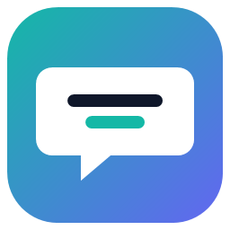
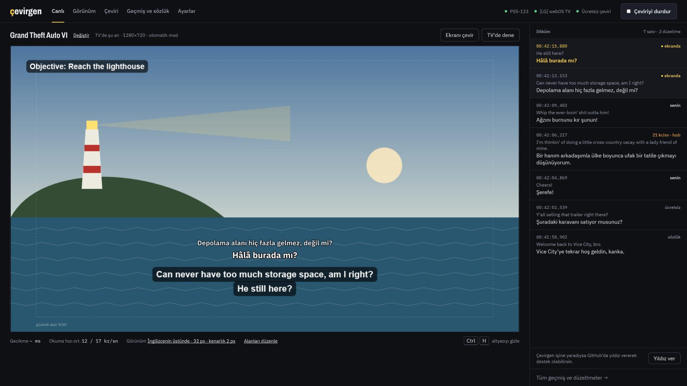
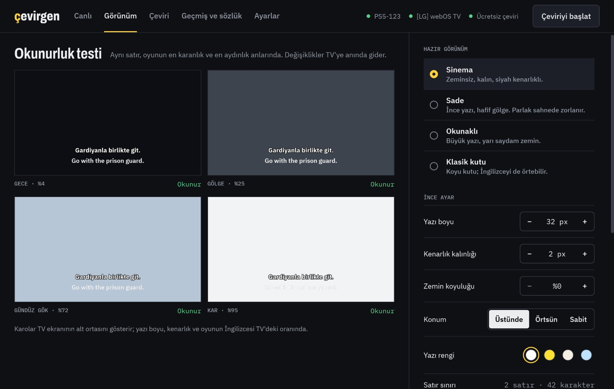
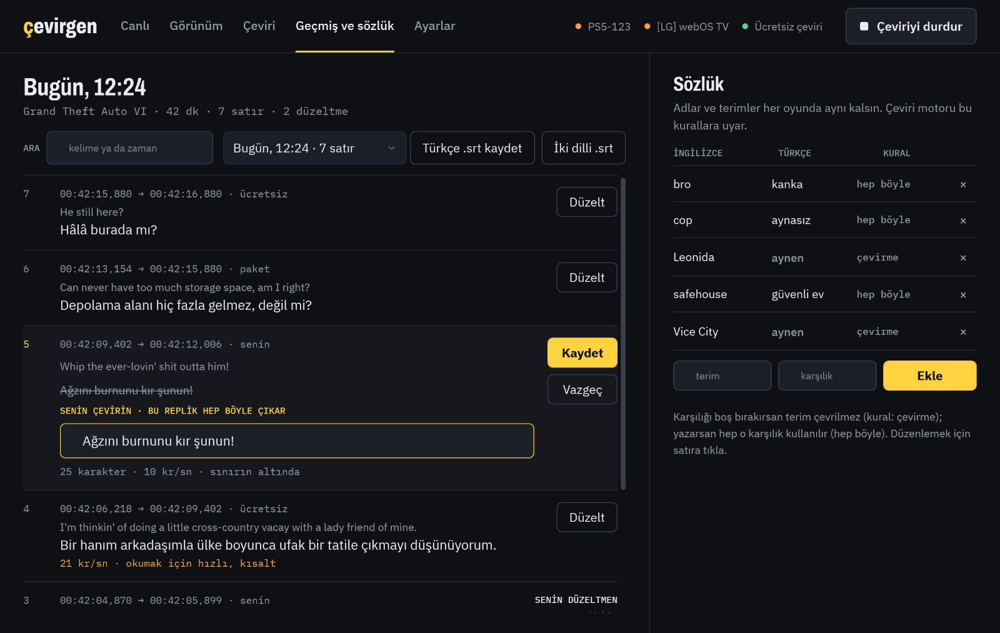
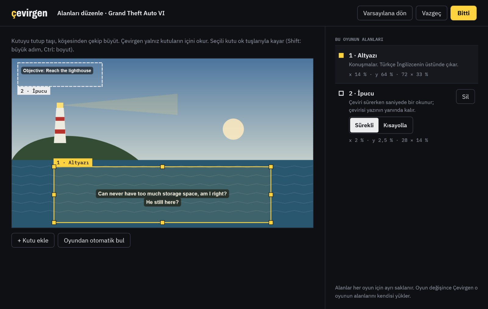

<p align="center"></p>

<h1 align="center">Çevirgen</h1>

<p align="center"><b>Oyunlar için canlı Türkçe altyazı.</b><br>
Ekrandaki İngilizce altyazıyı okur, Türkçeye çevirir ve TV'de oyunun üstünde gösterir. Altyazısı olan her oyunda çalışır.</p>

<p align="center">
  <a href="https://github.com/ozguradmin/cevirgen/releases/latest"><b>İndir (Windows)</b></a> ·
  <a href="#nasıl-çalışır">Nasıl çalışır</a> ·
  <a href="#gizlilik">Gizlilik</a> ·
  <a href="README.en.md">English</a>
</p>



## Ne yapar

- **Türkçesi olmayan oyunlara Türkçe altyazı.** Oyunun İngilizce altyazısını ekrandan okur, Türkçesini TV'de İngilizcenin hemen üstünde gösterir.
- **Her platform:** PS5, Xbox, bilgisayar oyunları ve yakalama kartıyla diğer konsollar.
- **İnternetsiz ücretsiz çeviri.** Varsayılan çeviri modeli bilgisayarında çalışır; yazılar dışarı çıkmaz. İstersen Gemini, DeepL, OpenAI, Claude ya da OpenAI uyumlu herhangi bir servisi (OpenRouter, Groq, LM Studio…) bağlarsın.
- **Okunur altyazı.** Zeminsiz, kenarlıklı yazı; okunurluk testiyle gece de kar sahnesinde de okunduğunu görürsün. Oyundaki altyazı gidince Türkçesi de hemen gider.
- **Düzelt ve sözlük.** Beğenmediğin çeviriyi düzeltirsin, o satır bir daha hep senin hâlinle gelir. "Vice City çevrilmesin", "bro hep kanka olsun" gibi kurallar koyarsın.
- **Okuma hızı.** Her satırın saniyedeki karakter sayısı ölçülür; profesyonel altyazı sınırını (17 kr/sn) aşan satırlar işaretlenir.
- **Oturumu .srt olarak kaydet.** Türkçe ya da iki dilli altyazı dosyası.
- **Kolay kurulum.** PS5 için 4 adım, bilgisayar oyunları için 2 adım.

## Ekranlar

| | |
|---|---|
|  |  |
| **İlk açılış** · PS5, Xbox, bilgisayar ya da diğer | **Görünüm** · aynı satır gece, gölge, gündüz ve karda |
|  |  |
| **Çeviri** · anahtarsız da çalışır, istersen kendi motorun | **Geçmiş ve sözlük** · satırın içinde düzelt, .srt kaydet |



## Nasıl çalışır

1. **Görüntü:** PS5'te Çevirgen, Uzaktan Oynatma ile ücretsiz ikinci bir PSN hesabından oyunun görüntüsünü izler; sen kendi hesabınla oynamaya devam edersin. Xbox'a kendisi bağlanır; bilgisayar oyunlarında oyun penceresini okur.
2. **Okuma:** Yalnız seçtiğin alanları (altyazı, ipuçları…) yazı tanımayla okur. Alanlar her oyun için ayrı saklanır.
3. **Çeviri:** Seçtiğin motorla Türkçeye çevirir; tuş ipuçlarını ve menü komutlarını ayrı tanır.
4. **Gösterim:** Türkçe satır Android TV'deki Çevirgen TV uygulamasıyla oyunun üstünde, ya da bilgisayar ekranında görünür.

## Kurulum

1. [Son sürümü indir](https://github.com/ozguradmin/cevirgen/releases/latest) ve `CevirgenApp-win-Setup.exe`'yi çalıştır.
2. Windows "tanınmayan uygulama" uyarısı verirse **Ek bilgi › Yine de çalıştır**'a bas. Yükleyici henüz imzalı değil; kaynak kodu bu depoda.
3. Çevirgen'i aç, "Oyunu nerede oynuyorsun?" sorusunu cevapla ve adımları izle.

**PS5 için önemli:** Ekranın üstünde sürekli "Uzaktan Oynatma'ya bağlandı" yazmasın diye PS5'te **Ayarlar › Sistem › Uzaktan Oynatma › Uzaktan Oynatma Bağlantı Durumu Açılır Penceresini Gizle**'yi aç; bunu hem kendi hesabında hem ikinci hesapta yap.

Güncellemeler uygulamanın içinden gelir; yeni sürüm çıkınca üstte bir bant görünür.

## Gizlilik

- **Anonim kullanım sayımı:** Kaç kişinin kullandığını görmek için 5 dakikada bir rastgele bir kimlik, sürüm ve platform gönderilir. Adın, oyunun içeriği, IP adresin saklanmaz.
- **Çevirileri iyileştirmeye katkı:** Ekranda okunan İngilizce satırlar ve çevirileri, oyunun adıyla gönderilir; e-posta, telefon numarası gibi kişisel bilgiler gönderilmeden süzülür. Amaç, çok oynanan oyunlar için daha iyi hazır çeviriler hazırlamak.
- İkisi de **Ayarlar › Uygulama**'dan kapatılır. Çeviri anahtarların yalnız bu bilgisayarda, şifreli saklanır.
- Ayrıntılar: [PRIVACY.md](PRIVACY.md).

## Destek ol

Çevirgen işine yaradıysa bu depoya ⭐ vererek destek olabilirsin. Hata ve öneriler için [sorun bildir](https://github.com/ozguradmin/cevirgen/issues).

## Geliştirme

Windows uygulaması .NET 10 (WPF) ile yazılmıştır: `windows/CouchSubs.Windows.slnx`.

```powershell
dotnet build windows/CouchSubs.Windows.slnx -c Release
dotnet test windows/CouchSubs.Windows.slnx -c Release --no-build
```

TV uygulaması `tv-android/` (Android TV) ve `tv-webos/` (TV sayfası), sunucu `server/cevirgen-api/` (Cloudflare Worker) altındadır. Sürüm paketi: `scripts/release-cevirgen.ps1`.

## Lisans ve teşekkür

Çevirgen, Sinan Yorulmaz'ın **[CouchSubs](https://github.com/yorulmazsinan/couchsubs)** uygulamasının değiştirilmiş bir sürümüdür (v0.1.0-beta.88 üzerine, 23 Kasım 2026'dan itibaren). CouchSubs © 2026 Sinan Yorulmaz. İkisi de [GNU AGPL-3.0](LICENSE) ile lisanslıdır; değişikliklerin tamamı git geçmişinde, özeti [NOTICE](NOTICE) dosyasındadır. Çevirgen, CouchSubs'ın yazarı ya da yayıncısı ile bağlantılı değildir; CouchSubs'ın çeviri paketleri Çevirgen'de yer almaz.

- Uzaktan Oynatma bağlantısı: [chiaki-ng](https://github.com/chiaki-ng/chiaki-ng) (AGPL-3.0)
- Çeviri modeli: OPUS-MT, Helsinki Üniversitesi (CC BY 4.0)
- Yazı tanıma: PP-OCR, PaddlePaddle (Apache-2.0)
- Yazı tipleri: IBM Plex, Archivo (SIL OFL 1.1)
- Diğer bileşenler: [THIRD-PARTY-NOTICES.md](THIRD-PARTY-NOTICES.md)

Çevirgen; Sony Interactive Entertainment, Microsoft ya da herhangi bir oyun yayıncısıyla bağlantılı değildir. "PlayStation" ve "PS5" Sony Interactive Entertainment Inc.'in, "Xbox" Microsoft Corporation'ın ticari markalarıdır. Ekran görüntülerindeki oyun sahnesi Çevirgen'in kendi çizimidir.
